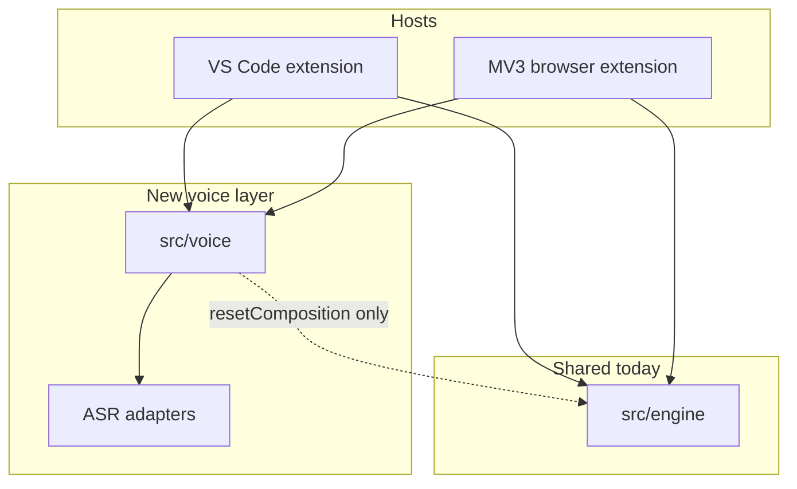
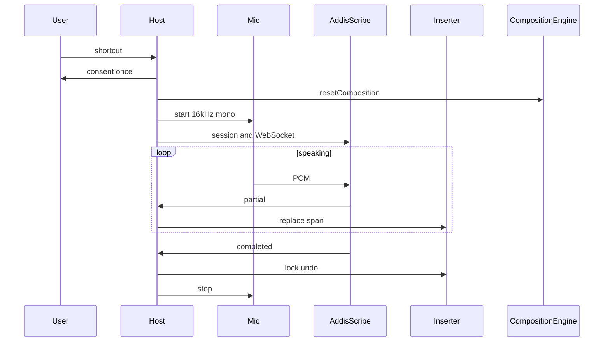

# Fidel Voice — ASR integration plan

Amharic speech-to-Ge'ez dictation for the Fidel VS Code extension and browser extension. **Planning only** — implementation is phased separately.

**Stack:** Bun + TypeScript + esbuild; shared core in `src/engine/`.

---

## Main ideas

| Topic | Decision |
|--------|----------|
| **Scope** | Amharic **ASR only** — mic → Ge'ez text. Not translation. Not Latin→Fidel phonetic typing. |
| **Pipeline** | One step: `speak → ASR → write Ge'ez in field → lock`. Models already output Ge'ez. |
| **Composition engine** | **Do not** feed ASR text into `CompositionEngine`. Before voice: `resetComposition()`. Insert with the same replace-span pattern as typing (`replaceLength`, one undo stop on lock). |
| **After lock** | Normal text — edit, undo, backspace. ASR fixes via **Ge'ez homophone swap** (from `mapping.ts`), not the transliterator. |
| **Default UX** | Engine **Auto**: Addis Scribe cloud (user key or optional Fidel proxy) → local sidecar if healthy → setup prompt. GPU/Docker/Hohe/Gemini under **Advanced**. |
| **Live ASR** | [Addis Scribe Streaming](https://huggingface.co/addisai/addis-scribe-streaming) — cloud WebSocket or local NeMo sidecar (GPU). |
| **Offline / CPU** | [Hohe](https://huggingface.co/snapwre/hohe-asr-amharic) via [hohe-serve](https://github.com/snapwre/hohe-serve) — per utterance, no live partials. |
| **Expectations** | ~28% WER on natural speech (Scribe); user reviews dictation. Amharic only. No punctuation from models. |

---

## Fidel today (where voice attaches)



**Typing (unchanged):** `src/extension.ts` → `src/vscode/inputInterceptor.ts` → `src/engine/composition.ts`. Browser: `src/browser/content/sessionManager.ts`, `standardInput.ts`, `contentEditable.ts`.

**Voice (new):** Parallel path; dedicated inserters; no Ge'ez on `type` / phonetic key handlers.

**UI:** Keep existing `FidelStatusBar` (ON/OFF/SKIPPED). Add a **second** status bar item — flat mic indicator **only while listening**; click stops. Browser: small dot + toolbar badge; no popups.

**Secrets:** VS Code `context.secrets` for Addis API key. Browser: `chrome.storage.local` only (never sync keys).

---

## ASR engines

### Addis Scribe — cloud (default live)

Source: [Addis Speech-to-Text docs](https://docs.addisassistant.com/docs/capabilities/speech-to-text).

- **File:** `POST /api/v1/scribe/transcribe`, header `x-api-key`, optional `stream=true`.
- **Live:** `POST /api/v1/scribe/sessions` → one-use ticket → WebSocket → `session.authenticate` → binary **PCM16 LE, 16 kHz mono** (~100 ms frames) → `audio.finish`.
- **Events:** `transcript.partial` (cumulative provisional text), `transcript.completed` (final + usage).
- **Limits:** 180 s per session; ticket expires in 60 s; Amharic; no punctuation.
- **Billing:** Final transcript characters (~3.5 ETB / 1000 chars). Persist `request_id`; use recover API on disconnect.

**Auth (v1):**

1. User Addis API key once (primary).
2. Optional later: Fidel-hosted session proxy (rate limits, privacy page). Try user key first, then proxy if configured.

Never ship a shared API key inside the extension.

**Hosts:**

- **VS Code:** Extension host mints session; hidden webview captures mic → PCM → WebSocket (spike first).
- **Browser:** Background mints session; offscreen document (MV3 `USER_MEDIA`) for mic + WebSocket; content script inserts text only.

### Addis Scribe — local (Advanced, GPU)

- Weights: `addisai/addis-scribe-streaming` (NeMo, `stream_infer.py`, chunk `320ms` or `1120ms`).
- Requires NVIDIA GPU + NeMo 3.0 — not for default users.
- Fidel: health check + PCM WebSocket to a thin local wrapper; same event shape as cloud adapter.
- No bundled Python in v1 — document + auto-detect only.

### Hohe — local (Advanced, CPU)

- Model: `snapwre/hohe-asr-amharic`, revision **`v1.0.1`** (language model files fixed Oct 2026).
- Run: `hohe-serve` Docker, `POST /transcribe` with audio.
- Fidel: VAD end-of-utterance → one request → single insert; strip `[AMH]` prefix.

**Download / run (power users):**

```bash
pip install -U huggingface_hub
huggingface-cli download snapwre/hohe-asr-amharic --revision v1.0.1 --local-dir ./hohe
# Confirm lm/am-5gram.bin and lm/decoder.json (alpha 0.3, beta 0.5)

git clone https://github.com/snapwre/hohe-serve && cd hohe-serve
docker build -t hohe-asr . && docker run --rm -p 8080:8080 hohe-asr
curl -F audio=@clip.ogg http://localhost:8080/transcribe
```

### Post–v1

- Gemini audio (quality unverified).
- Legacy Addis `speech.transcribe` / v2 STT as fallback only.
- Custom HTTP endpoint (Advanced).

---

## Voice core (`src/voice/`)

Host-agnostic: session state, routing, post-process. Mic and WebSocket live under `src/vscode/voice/` and `src/browser/voice/`.

**Engine interface (conceptual):**

```typescript
interface AsrEngine {
  connect(): Promise<void>;
  sendPcm(frame: Int16Array): void;
  finish(): void;
  abort(): void;
  on(event: "partial" | "final" | "error", handler): void;
}
```

**VoiceSession:**

1. Shortcut → one-time consent (local vs cloud) → listening.
2. First partial: reset phonetic composition; anchor cursor + track span length.
3. Each update: replace span with latest text; undo groups on lock.
4. Lock on `transcript.completed`, stop, or end-of-utterance (Hohe).
5. If user types or moves caret: lock or discard open voice span (same rules as `lastCompositionPosition`).

**Post-process on final:** strip `[AMH]`; apply user `fidel.dictionary` word replacements; no phonetic pass; punctuation deferred.

**Router:**

| Setting | Behavior |
|---------|----------|
| `auto` | scribe-cloud (key/proxy) → scribe-local → hohe-local → setup UI |
| explicit | Single engine, no silent fallback |

Settings: `fidel.voice.engine`, `fidel.voice.chunk`, `fidel.voice.proxyUrl`, `fidel.voice.localScribeUrl`, `fidel.voice.localHoheUrl`.

Commands: `fidel.voice.toggle`, `fidel.voice.stop`, `fidel.voice.openSettings`.

---

## VS Code

| Component | Path / note |
|-----------|-------------|
| Spike | Webview mic → Scribe WS → output channel |
| Controller | `src/vscode/voice/voiceController.ts` |
| Inserter | `src/vscode/voice/voiceInserter.ts` |
| Status | `VoiceStatusBar` — hidden when idle |
| Consent | `fidel.voice.consentGranted` |

Partials: in-place span replace in editor; optional muted decoration if easy.

---

## Browser (MV3)

| Component | Note |
|-----------|------|
| Manifest | `offscreen`, PTT command, host permissions for Addis API and `127.0.0.1` |
| Offscreen | Mic + WebSocket |
| Background | Session ticket; no API key in content script |
| Content | Voice span insert via existing input/contenteditable handlers |
| Rich editors | Final-only insert if live replace is unreliable |

Add esbuild entries for offscreen bundle + shared `src/voice`.

---

## Flow



---

## Phases

| Phase | Work |
|-------|------|
| **0** | Spike: VS Code webview → Scribe cloud |
| **1** | `src/voice` + VS Code MVP (cloud, key, status bar, insert, consent) |
| **2** | Browser MVP (offscreen, PTT, options) |
| **3** | Auto-detect Hohe + optional local Scribe URL |
| **4** | Homophone hover, Addis recover, errors, license attribution |
| **5** | Optional Fidel proxy, Gemini, Hohe install wizard |

---

## Risks

| Risk | Mitigation |
|------|------------|
| Mic in VS Code webview | Phase 0; native helper fallback if needed |
| Keys in browser | Ticket from background only |
| Addis 429 (one job) | Queue + clear message |
| Typing vs voice | Reset composition on voice start; lock span on caret move |
| Hohe not streaming | `supportsPartials: false` |
| Local Scribe needs GPU | Advanced only |

---

## Out of scope

- Ge'ez through `CompositionEngine` / transliterator changes.
- Required Docker/Python/NeMo for default install.
- Translation or non-Amharic ASR.
- Replacing existing ፊደል ON/OFF status bar.

---

## Success criteria

- User with Addis key: shortcut → consent → speak → Ge'ez at cursor with live partials (Scribe).
- Phonetic typing and voice in the same document without interference.
- Browser: plain `<textarea>` on a common site.
- Auto: cloud when keyed; localhost Hohe when running without manual engine pick.

---

## References

- Addis Scribe Streaming: https://huggingface.co/addisai/addis-scribe-streaming  
- Addis Scribe API: https://docs.addisassistant.com/docs/capabilities/speech-to-text  
- Hohe ASR: https://huggingface.co/snapwre/hohe-asr-amharic  
- Hohe serve: https://github.com/snapwre/hohe-serve  
